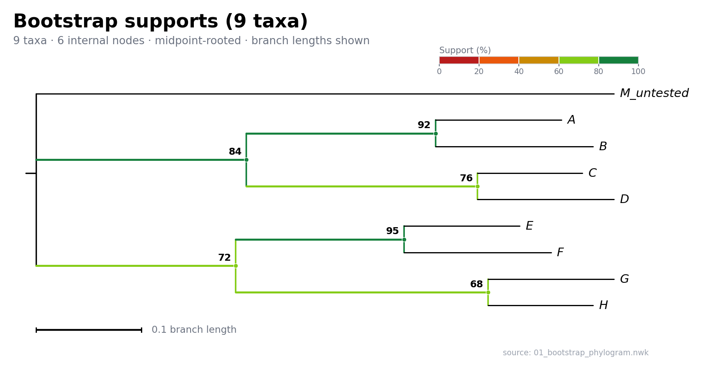

# Newick Phylogram

Render a Newick tree as a **midpoint-rooted, support-annotated phylogram** PNG with adaptive height and support-aware branch colors.


<p align="center">
  
</p>

```bash
python newick_phylogram.py tree.nwk
# -> tree.png (same directory as the input)
```

> [!NOTE]
> `newick_phylogram.py` is the preserved baseline renderer. For large jobs, use
> [`batch_render_pool.py`](batch_render_pool.py): `ProcessPoolExecutor` + the baseline
> renderer, with PNG zlib compression fixed at level 6. See [FAST.md](FAST.md) for
> the 200k-image benchmark notes (in Chinese).

---

## Contents

- [Features](#features)
- [Installation](#installation)
- [Quick start](#quick-start)
- [CLI options](#cli-options)
- [Supported support values](#supported-support-values)
- [Leaf labels](#leaf-labels)
- [Rerooting and branch lengths](#rerooting-and-branch-lengths)
- [Layout and output](#layout-and-output)
- [Examples](#examples)
- [Batch rendering](#batch-rendering)
- [Project structure](#project-structure)
- [Validation](#validation)
- [Known limitations](#known-limitations)

---

## Features

- Newick parsing with **Biopython** and rectangular phylogram rendering with **Matplotlib**.
- **Midpoint rerooting** by default (midpoint of the longest leaf-to-leaf path); optional outgroup rooting.
- Support values are shown in two complementary ways:
  - **numeric labels** at the upper-left of internal nodes, outside the branch line;
  - **branch colors** using five discrete bins: `0–20 / 20–40 / 40–60 / 60–80 / 80–100`.
- Vertical connectors inherit the color of their parent node.
- Root, leaf branches, leaf labels, and branches without support are black.
- Automatic detection of both **bootstrap** (`0–100`) and **posterior probability** (`0–1`) scales.
- Italic leaf labels, with cleanup of accidental outer quotes and escaped quotes.
- Figure title, subtitle (taxa, internal nodes, rooting method), and source filename.
- Adaptive figure height based on the number of tips and nodes.
- Automatic width expansion for topology-only trees.
- Handles polytomies, quoted names with spaces, unary nodes, two-tip trees, and all-zero branch lengths.
- Falls back to a clearly labeled topology-only drawing when branch lengths are missing, incomplete, or all zero.
- Includes ten example `.nwk` files and their rendered `.png` outputs.

## Installation

Python **3.10+** is required.

```bash
python -m pip install -r requirements.txt
# or
python -m pip install biopython matplotlib
```

Dependencies:

- `biopython` — Newick parsing
- `matplotlib` — rendering
- `tqdm` — progress bar for batch rendering

### Font handling

The script resolves the installed font list at runtime. It selects one CJK fallback family (when available), prefers a family with a real bold face, and writes only installed families into Matplotlib. This avoids:

```text
findfont: Font family '...' not found
```

Benign weight/style fallback messages for CJK fonts without a true bold/italic face are filtered; genuine missing-family messages are still visible.

If no CJK font is installed, Chinese labels cannot be rendered. Install a CJK font or register one in `font.family` / `font.sans-serif`.

Tested with Python 3.13.5, Biopython 1.85, and Matplotlib 3.10.1.

## Quick start

```bash
# Default: write tree.png next to tree.nwk; title = filename stem
python newick_phylogram.py tree.nwk

# Custom title, output path, and resolution
python newick_phylogram.py tree.nwk \
    --title "My phylogeny (ML bootstrap)" \
    --output figures/tree.png \
    --dpi 300

# Root on one or more outgroup taxa
# (multiple taxa use their MRCA as the outgroup side)
python newick_phylogram.py tree.nwk \
    --outgroup "Homo sapiens" "Pan paniscus"

# Select the second tree in a multi-tree Newick file (zero-based)
python newick_phylogram.py trees.nwk --tree-index 1

# Keep the post-reroot child order instead of ladderizing by clade size
python newick_phylogram.py tree.nwk --no-ladderize
```

## CLI options

| Option | Description |
|---|---|
| `newick` | Input Newick file (`.nwk`, `.tree`, or any text file) |
| `-o, --output` | Output PNG path; default `<input stem>.png` |
| `--title` | Figure title; default is the input filename stem |
| `--outgroup TAXON ...` | Reroot on the given taxon/taxa instead of the midpoint |
| `--tree-index N` | Select tree N in a multi-tree file (zero-based, default `0`) |
| `--dpi N` | PNG resolution; default `200`, minimum `200` |
| `--support-scale auto\|fraction\|percent` | Interpret supports as `0–1` or `0–100`; `auto` uses `0–1` when the maximum is ≤ 1 |
| `--no-ladderize` | Do not sort children by clade size |
| `--png-compress-level {0-9}` | PNG zlib level; default `6` |
| `--version` | Print the version |

## Supported support values

All of these forms are recognized:

```text
((A:0.1,B:0.2)95:0.3,C:0.4);               # 0-100 internal label
((A:0.1,B:0.2)0.95:0.3,C:0.4);             # 0-1 internal label
((A:0.1,B:0.2)[&support=95]:0.3,C:0.4);    # Newick comment
((A:0.1,B:0.2)[&bootstrap=0.95]:0.3,C:0.4);
((A:0.1,B:0.2)[&posterior=0.95]:0.3,C:0.4);
((A:0.1,B:0.2)[&prob=95]:0.3,C:0.4);
((A:0.1,B:0.2)[95]:0.3,C:0.4);
```

Display rules:

- Numeric support labels are placed at the upper-left of internal nodes, outside the branch line.
- The semi-transparent white label background covers only the text area and does not obscure branches.
- Internal branches and their parent connectors share the same five-color scale:
  - `0–20` red
  - `20–40` orange
  - `40–60` gold
  - `60–80` bright yellow-green
  - `80–100` forest green
- Root and leaf branches are black. Internal branches without support are black as well.
- A short black stub marks the root; it carries no support value.
- `auto` scale: if every support is ≤ 1, supports are treated as `0–1`; otherwise as `0–100`.
- Mixed `0–1` and `0–100` values trigger a warning and are treated as percentages by default; use `--support-scale` to override.
- Non-numeric internal labels are not treated as support values. Support values are not drawn on tips.
- Midpoint rooting does not create root support. With `--outgroup`, a root support value may be shown as `root 96` next to the root.

> Support values are preserved per edge/bipartition. Each original support value appears once after rerooting. If the midpoint falls inside an edge, the value is attached to the larger of the two resulting clades.

### Leaf label cleanup

Some exporters leave literal quote artifacts in parsed names. The renderer removes quote and backslash characters only at the ends of a label:

| Parsed label | Rendered label |
|---|---|
| `'Homo sapiens'` | `Homo sapiens` |
| `\'Homo sapiens\'` | `Homo sapiens` |
| `Homo sapiens'` | `Homo sapiens` |
| `'O'Brien'` | `O'Brien` |

Internal apostrophes are preserved. Cleaned names are also used for `--outgroup` matching.

## Rerooting and branch lengths

### Midpoint rerooting

1. Convert the tree to an undirected adjacency graph, keeping edge lengths and edge support values.
2. Find the longest leaf-to-leaf path (diameter) with a linear-time tree DP.
3. Take its midpoint:
   - if the midpoint is an existing node, root there;
   - otherwise split the edge and insert a new root.
4. Reorient the tree from the new root, preserving all branch lengths, then collapse unary nodes.
5. The implementation is independent of Biopython's `root_at_midpoint`, which can duplicate or inflate branch lengths for some small/star trees. Rerooting was validated against 500 random trees: pairwise leaf distances, total branch length, and support count are unchanged.

### Outgroup rooting

`--outgroup` uses Biopython's `root_with_outgroup`; multiple taxa are rooted at their MRCA.

### Missing branch lengths

- If every non-root edge has a valid non-negative length and the total length is positive, a real phylogram with a scale bar is drawn.
- If lengths are missing, negative, non-finite, or all zero, every edge is initially set to one unit and a topology-only drawing is produced. The scale bar is omitted and the reason is printed on the figure.
- Rerooting, support values, title, and adaptive height are retained in topology-only mode.

## Layout and output

Figure height in inches:

```text
max(3.4, 0.28 * n_taxa + 1.8, 0.10 * n_nodes + 1.8)
```

Figure width in inches:

```text
max(8.0, min(18.0, 7.0 + 0.05 * n_taxa + 0.08 * longest_taxon_name))
```

Topology-only trees receive extra width:

```text
min(20.0, max(width + 2.5, 10.0 + 0.05 * n_taxa))
```

Other layout details:

- The title/legend area uses a fixed physical height, avoiding excessive whitespace on tall figures.
- Leaf labels may extend outside the axes; `bbox_inches="tight"` includes them in the PNG.
- The default and minimum DPI is 200.
- A 100-taxon test produces a 2455 × 6001 px PNG.
- PNG is written with `optimize=True`. Sample outputs are 43–214 KiB; the 100-taxon test is about 493 KiB.

### Why PNG instead of JPEG?

These figures are mostly thin lines, small text, and flat color. PNG's lossless compression works well and produces small files. JPEG can reduce file size further but introduces ringing/blur around branches and support labels. The default output is therefore PNG.

For other formats, change the suffix in `fig.savefig(...)` to `.pdf` or `.svg` (vector output is preferable for publication), or use `.jpg` with `pil_kwargs={"quality": 95}`. The CLI intentionally emits PNG.

## Examples

`examples/` contains both `.nwk` inputs and rendered `.png` outputs.

| Input | Preview | Taxa | Coverage |
|---|---|---:|---|
| [01_bootstrap_phylogram.nwk](examples/01_bootstrap_phylogram.nwk) | [PNG](examples/01_bootstrap_phylogram.png) | 9 | 0–100 bootstrap, standard phylogram |
| [02_posterior_phylogram.nwk](examples/02_posterior_phylogram.nwk) | [PNG](examples/02_posterior_phylogram.png) | 10 | 0–1 posterior, automatic scale switch |
| [03_unrooted_no_support.nwk](examples/03_unrooted_no_support.nwk) | [PNG](examples/03_unrooted_no_support.png) | 8 | Trifurcating/unrooted input, no support |
| [04_no_branch_lengths.nwk](examples/04_no_branch_lengths.nwk) | [PNG](examples/04_no_branch_lengths.png) | 9 | No branch lengths, topology-only fallback |
| [05_partial_branch_lengths.nwk](examples/05_partial_branch_lengths.nwk) | [PNG](examples/05_partial_branch_lengths.png) | 8 | Incomplete branch lengths |
| [06_quoted_names_polytomy.nwk](examples/06_quoted_names_polytomy.nwk) | [PNG](examples/06_quoted_names_polytomy.png) | 7 | Quoted names with spaces, polytomy |
| [07_comment_support.nwk](examples/07_comment_support.nwk) | [PNG](examples/07_comment_support.png) | 7 | `[&support=]`, `[&bootstrap=]`, `[&posterior=]` |
| [08_large_tree_40_taxa.nwk](examples/08_large_tree_40_taxa.nwk) | [PNG](examples/08_large_tree_40_taxa.png) | 40 | Adaptive height, many support values |
| [09_two_taxa.nwk](examples/09_two_taxa.nwk) | [PNG](examples/09_two_taxa.png) | 2 | Minimal tree, midpoint splits the only edge |
| [10_all_zero_lengths.nwk](examples/10_all_zero_lengths.nwk) | [PNG](examples/10_all_zero_lengths.png) | 8 | All branch lengths zero |

Selected outputs:

- [Bootstrap support example](examples/01_bootstrap_phylogram.png)
- [Topology-only example](examples/04_no_branch_lengths.png)
- [40-taxon example](examples/08_large_tree_40_taxa.png)

Regenerate everything:

```bash
python generate_examples.py
```

The script rewrites the ten `.nwk` files and renders each with its demonstration title.

## Batch rendering

For large collections, use [`batch_render_pool.py`](batch_render_pool.py). It
imports the baseline renderer in each worker, keeping Matplotlib
initialization out of the parent process.

```bash
python batch_render_pool.py INPUT_DIR OUTPUT_DIR --jobs 8
```

Windows example:

```bat
python batch_render_pool.py D:\trees D:\png --jobs 8
```

The input directory is scanned non-recursively on the first run (or with
`--rebuild-lists`). Point the command at a small test directory first if you
want to benchmark before a full run.

### Cached input lists

On the first run (or with `--rebuild-lists`), the batch parses every input and
classifies it by taxa count:

```text
OUTPUT_DIR/list_small.txt    # <= --big-threshold taxa
OUTPUT_DIR/list_big.txt      # >  --big-threshold taxa
OUTPUT_DIR/list_invalid.txt  # parse errors / no trees
OUTPUT_DIR/list_meta.json    # cache metadata
```

The default threshold is **500 taxa** (`--big-threshold N`). Invalid files are
reported in full in `list_invalid.txt` and are not sent to workers.

Later runs read these lists instead of scanning or parsing the input directory
again. Use `--rebuild-lists` after adding/removing input files or changing a
tree's content. Changing `--big-threshold`, the input path, or the pattern
rebuilds the lists automatically.

### Processing order

1. **Small trees**: rendered in parallel with `--jobs` workers.
2. **Large trees**: after the small phase finishes, rendered strictly serially
   by a single-worker process pool.

This means a few huge trees cannot occupy all workers and cannot race each
other for memory. There is **no taxa cap**: every valid tree is processed.

The batch height is capped at **120 inches** (24,000 px at 200 DPI) so one
extreme figure cannot grow without bound. All leaves are still drawn, but
vertical spacing is compressed on extreme trees. For a full-height render of
an extreme tree, use the single-file renderer.

Other behavior:

- existing PNGs are skipped by default; output existence is checked with one
  `os.listdir()` of the output directory, not one `Path.exists()` per input;
- `--overwrite` bypasses that listing and re-renders everything;
- a malformed tree is listed as invalid and does not stop the batch;
- each worker initializes Matplotlib once and performs a warm-up;
- PNG zlib level is fixed at **6**;
- progress and ETA are shown with `tqdm`;
- workers record their current input, so a crash reports the last in-flight
  files.

### Large trees and recursion

Biopython's Newick parser itself is iterative, but its tree traversal helpers
(`find_clades`, `get_terminals`, `ladderize`) use recursive DFS. A very deep
ladder tree can therefore hit Python's default recursion limit around 1000
levels.

`batch_render_pool.py` raises the interpreter recursion limit to **100,000**
at module import, before parsing or traversing any tree.

On a 31 GiB Linux host at 200 DPI, a 1200-tip deep tree with the batch height
cap rendered in about 9.5 s and produced a 3448 × 24,041 px, 2.4 MiB PNG
(82.8 M pixels). Before the cap it produced 233,088,248 pixels. A single tree
can still exceed available RAM; the OS may then kill the worker without a
Python traceback. In that case, process that tree separately and be prepared
for several GB of RAM. The recursion limit can still be exceeded by trees
deeper than 100,000 levels.

### Skip existing or overwrite?

Skipping is still preferable for a rerun: one `os.listdir()` of the output
directory is cheap, while overwriting tens of thousands of PNGs costs hours.
Use `--overwrite` only when existing outputs are known to be stale or generated
with different settings.

Measured on an 8-core / 16-thread Ryzen 7 3700X at 200 DPI with 9-taxon trees and PNG zlib 6:

| Configuration | 500 images |
|---|---:|
| 8 workers | 14.14 s — **35.4 images/s** |
| 16 workers | 10.58 s — **47.3 images/s** |

Estimated 200k runtime: about **1.6 h** with 8 workers, **1.2 h** with 16 workers (Linux). Windows throughput will differ; benchmark on a small test directory first.

> [!WARNING]
> If a worker is killed by the OS (`BrokenProcessPool`), already-written PNGs are kept. The batch prints a partial summary, the first 20 per-file errors, empty/no-tree inputs, and the last in-flight input recorded by each worker. Rerun with fewer `--jobs` (for example `--jobs 4`) and inspect the reported in-flight files; big trees are already serial in their own phase. On Linux also check `dmesg` for OOM kills. Workers also enable `faulthandler`, so native crashes can produce a Python traceback.

> [!NOTE]
> `InterpreterPoolExecutor` is not used. On Python 3.14, importing Matplotlib inside a `ProcessPool` worker works, but inside an `InterpreterPool` worker it fails because NumPy's C extension currently refuses subinterpreter loading. `ProcessPoolExecutor` is the supported path.

See [FAST.md](FAST.md) for the detailed evaluation (in Chinese).

## Project structure

```text
newick_phylogram/
├── newick_phylogram.py       # baseline renderer / CLI
├── batch_render_pool.py      # ProcessPoolExecutor batch renderer
├── FAST.md                   # 200k benchmark and design notes
├── generate_examples.py      # regenerate test data and PNGs
├── requirements.txt
├── README.md
└── examples/
    ├── *.nwk                 # ten test trees
    └── *.png                 # rendered outputs
```

## Validation

- All ten examples render successfully; support counts, leaf names, and total branch lengths were checked.
- Pairwise leaf distances before/after rerooting were verified for all examples with usable branch lengths.
- 500 random trees (2–15 taxa, with support values) passed distance, total-length, and support-count checks.
- Simulating a missing `Droid Sans Fallback` font produces no `findfont: Font family ... not found` warning.
- A Windows-like font set (Source Han Sans SC and SimHei without bold, Microsoft YaHei with bold) selects Microsoft YaHei as the single CJK fallback.
- Weight/style fallback messages are filtered, while genuine missing-family messages remain visible.
- Quote cleanup and internal apostrophes (`O'Brien`) are tested.
- A 100-taxon stress test produces a 2455 × 6001 px, ~493 KiB PNG in about 2.5 s.
- Batch rendering was tested at 500 images with 0 failures; `spawn` mode was tested for Windows-like behavior.
- A malformed Newick file returns an error for that file while the rest of the batch continues.

## Known limitations

- One PNG per invocation; multi-tree files require `--tree-index`.
- PNG is the only CLI output format. Change `fig.savefig(...)` if PDF/SVG is needed.
- Only numeric internal labels and common Newick support comments are interpreted as support values; non-numeric internal labels are not drawn.
- Leaf labels are italic by default. CJK fonts without a true italic face may render upright.
- Branch-length units are unknown from Newick; the scale bar shows only the numeric value.
- Very large trees produce physically large PNGs. The 200 DPI minimum is intentional; consider splitting the tree or adjusting the height formula instead of lowering DPI.
